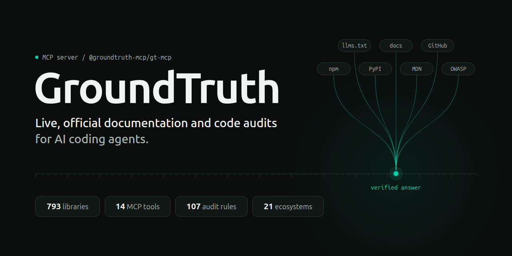
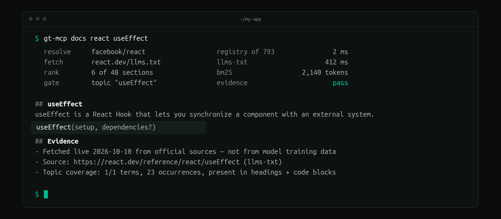
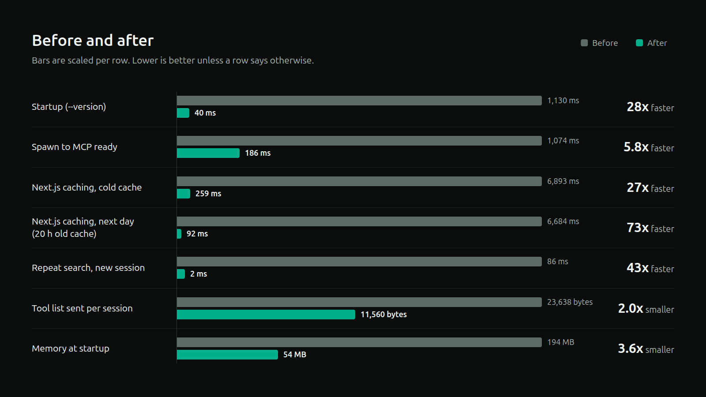
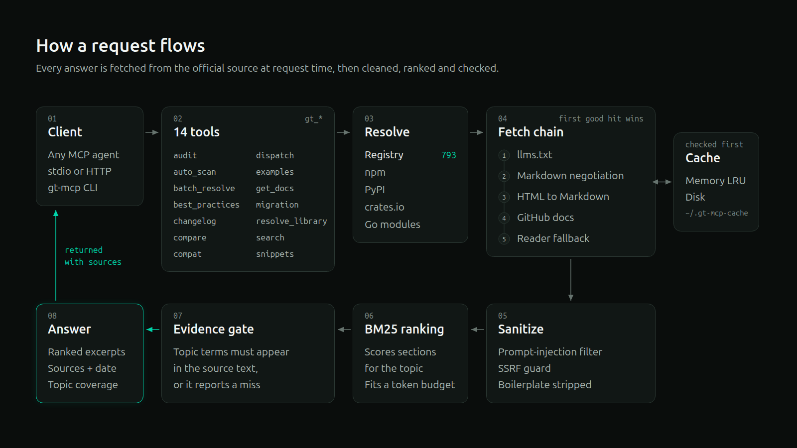
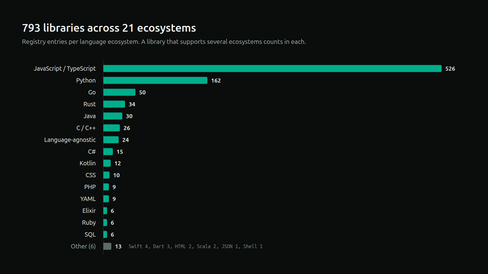

<p align="center">
  
</p>

<h3 align="center">Current, official documentation for coding agents, fetched when they ask.</h3>

<p align="center">
  <a href="https://www.npmjs.com/package/@groundtruth-mcp/gt-mcp"></a>
  <a href="https://github.com/rm-rf-prod/GroundTruth-MCP/actions/workflows/ci.yml"></a>
  <a href="./LICENSE"></a>
  
  
  
  
  
</p>

GroundTruth is a self-hosted MCP server and command-line tool. Models write code from what they were trained on, so they still wrap components in `forwardRef` after React 19 made `ref` a regular prop, call `cookies()` synchronously after Next.js made it async, and emit `@tailwind` directives that Tailwind v4 replaced with `@import "tailwindcss"`. GroundTruth gives the agent the library's own documentation at request time: it reads `llms.txt`, the docs site as markdown, or the GitHub repository, ranks the sections that answer the question, and checks that the answer covers the topic before returning it. It also audits your source with 107+ patterns and links every finding to the current fix. It runs on your machine. No account, no API key, no rate limit of its own.

---

## Install (60 seconds)

Requires Node.js 24 or newer.

**Claude Code**

```bash
claude mcp add gt -- npx -y @groundtruth-mcp/gt-mcp@latest
```

**Cursor, Claude Desktop, Windsurf** and other clients that use an `mcpServers` block (`.cursor/mcp.json`, `claude_desktop_config.json`, `~/.codeium/windsurf/mcp_config.json`):

```json
{
  "mcpServers": {
    "gt": {
      "command": "npx",
      "args": ["-y", "@groundtruth-mcp/gt-mcp@latest"]
    }
  }
}
```

**VS Code** (`.vscode/mcp.json`):

```json
{
  "servers": {
    "gt": {
      "type": "stdio",
      "command": "npx",
      "args": ["-y", "@groundtruth-mcp/gt-mcp@latest"]
    }
  }
}
```

Any other MCP client: run `npx -y @groundtruth-mcp/gt-mcp@latest` as a stdio server.

**Command line** (same tools, no MCP client needed):

```bash
npm install -g @groundtruth-mcp/gt-mcp
gt-mcp bp nextjs caching
```

`@latest` makes npx pick up new releases on the next session start. When a newer version exists, tool responses carry a one-line notice (`GT_NO_UPDATE_CHECK=1` turns the check off).

### Optional: GitHub token

GroundTruth reads READMEs, release notes, migration guides and code examples from GitHub. Without a token GitHub allows 60 requests per hour. A token with no extra scopes raises that to 5,000 and enables code search in `gt_examples`.

```bash
claude mcp add gt -e GT_GITHUB_TOKEN=ghp_yourtoken -- npx -y @groundtruth-mcp/gt-mcp@latest
```

In a JSON config, add `"env": { "GT_GITHUB_TOKEN": "ghp_yourtoken" }` next to `args`.

---

## What you get

Fourteen tools. Each does one job, and each is also a CLI command.

| Tool | CLI | What it does |
|---|---|---|
| `gt_dispatch` | `ask` | Routes a plain request ("use gt for drizzle migrations") to the right tool and arguments |
| `gt_resolve_library` | `resolve` | Finds a library by name; falls back to npm, PyPI, crates.io and Go modules |
| `gt_get_docs` | `docs` | Live docs for one topic; also accepts a docs URL |
| `gt_best_practices` | `bp` | Patterns, anti-patterns and configuration guidance for a library |
| `gt_auto_scan` | `scan` | Reads your manifest and fetches best practices for each dependency |
| `gt_search` | `search` | Any topic without a library: OWASP, MDN, web.dev, W3C, AI provider docs, Google APIs |
| `gt_audit` | `audit` | Scans source files and reports issues at `file:line` with links to the fix |
| `gt_changelog` | `changelog` | Release notes before you upgrade |
| `gt_compat` | `compat` | Browser and runtime support from MDN browser-compat-data and caniuse |
| `gt_compare` | `compare` | Two or three libraries side by side |
| `gt_examples` | `examples` | Real-world code from GitHub |
| `gt_migration` | `migrate` | Migration guides and breaking changes between versions |
| `gt_batch_resolve` | `batch` | Resolves up to 20 libraries in one call |
| `gt_snippets` | `snippets` | Ranked code snippets per library and version, cached on disk |

The server also exposes 2 MCP resources (`library-registry`, `library-docs`) and 8 prompts (`audit-my-project`, `upgrade-check`, `best-practices-scan`, `compare-libraries`, `security-check`, `migration-guide`, `find-examples`, `dependency-audit`).

You don't need the tool names. Ask in plain language:

```
use gt for nextjs
use gt for drizzle migrations
gt audit
use gt to check WCAG focus indicators
use gt for OpenTelemetry setup
find all issues and fix with gt
```

Or call tools directly:

```typescript
gt_resolve_library({ libraryName: "nestjs" })
gt_get_docs({ libraryId: "nestjs/nest", topic: "guards" })
gt_best_practices({ libraryId: "vercel/next.js", topic: "caching" })
gt_auto_scan({ projectPath: "." })
gt_search({ query: "OWASP SQL injection prevention" })
gt_audit({ projectPath: ".", categories: ["security", "accessibility"] })
gt_changelog({ libraryId: "vercel/next.js", version: "15" })
gt_compat({ feature: "CSS container queries", environments: ["safari"] })
gt_compare({ libraries: ["prisma", "drizzle-orm"], criteria: "TypeScript support" })
gt_examples({ library: "hono", pattern: "middleware" })
```

### `gt_audit`

Walks your project, runs 107+ patterns across 18 categories, reports each issue at `file:line`, then fetches the fix from the authoritative source.

```
gt_audit({ categories: ["all"] })                      // all 18 categories
gt_audit({ categories: ["security", "node"] })         // OWASP + Node.js
gt_audit({ categories: ["python", "security"] })       // Python OWASP scan
gt_audit({ categories: ["accessibility"] })            // WCAG AA
gt_audit({ categories: ["typescript", "react"] })      // type safety + React rules
```

| Category | What it checks |
|---|---|
| `security` | XSS, SQL injection, command injection, SSRF, path traversal, hardcoded credentials, CORS wildcard |
| `accessibility` | Missing alt text, onClick on div, icon-only buttons, inputs without labels, `outline: none` |
| `react` | forwardRef (React 19), useFormState renamed, index as key, conditional hooks |
| `nextjs` | Sync cookies/headers/params (Next.js 16), Tailwind v3 directives, missing metadata |
| `typescript` | `any` type, non-null assertions, `@ts-ignore`, floating Promises |
| `performance` | Missing lazy loading, useEffect data fetching, missing Suspense boundaries |
| `layout` | CLS-causing images, 100vh on mobile, missing font-display |
| `node` | console.log in production, sync fs ops, unhandled callbacks |
| `python` | SQL injection via f-string, eval/exec, subprocess shell=True, pickle.loads |
| Also | `mobile`, `css`, `vue`, `svelte`, `angular`, `testing`, `seo`, `i18n`, `api` |

Sample output:

```
## [CRITICAL] SQL built via template literal
Category: security | Severity: critical | Count: 2

Fix: db.query('SELECT * FROM users WHERE id = $1', [userId])

Files:
  - src/db/users.ts:47
  - src/api/search.ts:23

Live fix: OWASP SQL Injection Prevention Cheat Sheet
```

### `gt_auto_scan`

Point it at a project root. It reads the manifest and lockfile, works out which libraries you use and at which versions, and returns best practices for each, top libraries first. Default output is about 15K characters.

Reads `package.json`, `deno.json`, `requirements.txt`, `pyproject.toml`, `Cargo.toml`, `go.mod`, `pom.xml`, `build.gradle`, `build.gradle.kts`, `composer.json`, `Gemfile` and `pubspec.yaml`.

### `gt_search`

For anything that isn't one library.

| Area | Topics |
|---|---|
| Security | OWASP Top 10, SQL injection, XSS / CSP, CSRF, HSTS, CORS, JWT, OAuth 2.1, WebAuthn, SSRF, API security |
| Accessibility | WCAG 2.2, WAI-ARIA, keyboard navigation |
| Performance | Core Web Vitals, image optimization, web fonts, Speculation Rules |
| Web APIs | Fetch, Workers, WebSocket, WebRTC, IndexedDB, Web Crypto, Intersection Observer |
| CSS | Grid, Flexbox, Container Queries, View Transitions, Cascade Layers, :has(), Subgrid |
| AI providers | Claude, OpenAI, Gemini, Mistral, Cohere, Groq, LangChain, LlamaIndex |
| Google | Maps, Analytics, Ads, Cloud, Firebase, Vertex AI, YouTube, Gmail, Sheets |
| Infrastructure | Docker, Kubernetes, GitHub Actions, Terraform, Cloudflare Workers |

---

## CLI

<p align="center">
  
</p>

`gt-mcp <command>` runs the same 14 tools in-process and prints the answer. With no arguments, `gt-mcp` is the stdio MCP server, exactly as before.

```bash
gt-mcp docs react useEffect                  # live docs for one topic
gt-mcp bp nextjs caching                     # best practices
gt-mcp search "OWASP SSRF prevention"
gt-mcp audit .                               # audit the current project
gt-mcp scan .                                # best practices for every dependency
gt-mcp compat "CSS container queries"
gt-mcp ask "how do I paginate with drizzle"  # let gt_dispatch pick the tool
gt-mcp call gt_compare '{"libraries":["prisma","drizzle-orm"]}'
echo '{"libraryName":"drizzle"}' | gt-mcp call gt_resolve_library -
```

| Command | Does |
|---|---|
| `tools` | Lists every command, its tool and its arguments (`--json` for machine output) |
| `call <tool> [<json>\|-]` | Calls any tool with JSON arguments; `-` reads them from stdin |
| `help [command]` | Shows a command's flags, generated from the tool's input schema |
| `--json` | Prints the full `CallToolResult` as JSON instead of the text |

Exit codes: `0` ok, `1` tool error, `2` usage error. Logs stay quiet on stderr unless something goes wrong (`GT_LOG_LEVEL` defaults to `warn` for commands). The server flags still work: `--version`, `--health`, `--routing-table`, `--help`.

---

## Performance

<p align="center">
  
</p>

Measured on one machine with the same harness, published 7.5.0 against 8.0.0. Network timings depend on your connection and on the docs site.

| Measurement | 7.5.0 | 8.0.0 | Change |
|---|---|---|---|
| `gt-mcp --version` | 1,130 ms, 194 MB | 40 ms, 54 MB | 28x faster |
| Spawn to MCP ready | 1,074 ms | 186 ms | 5.8x faster |
| `gt_best_practices` Next.js caching, cold cache | 6,893 ms | 259 ms | 27x faster |
| Same call the next day (20 h old cache) | 6,684 ms | 92 ms | 73x faster |
| Repeat `gt_search` in a new session | 86 ms | 2 ms | 43x faster |

Fewer tokens per session and per answer:

| Measurement | 7.5.0 | 8.0.0 |
|---|---|---|
| `tools/list`, paid by every session | 23,638 bytes | 11,560 bytes (-51%) |
| Tool descriptions | | -75% |
| Wire bytes per docs or best-practices answer | | halved (duplicate `structuredContent` removed) |
| `gt_auto_scan` default output | ~60K characters | ~15K characters |
| `gt_dispatch` reply | 2.7K characters | 0.9K characters |

More of the answer reaches the model in clients that display `structuredContent` instead of the text:

| Tool | 7.5.0 | 8.0.0 |
|---|---|---|
| `gt_compat` | 220 characters | the full support table |
| `gt_examples` | 142 characters | 3.5K characters |

Where the time went: the binary is a small bootstrap that loads the server lazily and uses the Node compile cache; docs pages are requested as markdown; the reader service is only a fallback; and cached pages are served stale-while-revalidate. A page up to 7 days old is returned at once and refreshed in the background.

---

## How it works

<p align="center">
  
</p>

1. **Resolve.** The library name is matched against the curated registry, then npm, PyPI, crates.io and Go modules.
2. **Cache.** An in-memory LRU, bounded by entry count and by characters, then the disk cache in `~/.gt-mcp-cache`.
3. **Fetch.** Sources are tried in order and the first useful one wins:
   1. `llms.txt` / `llms-full.txt`, the files maintainers publish for LLMs. A nested `llms.txt` resolves to the library's own index.
   2. The docs page as markdown, via `Accept: text/markdown` content negotiation where the site supports it. The Next.js caching page is 715 KB as HTML and 16 KB as markdown.
   3. The HTML page, converted to markdown directly.
   4. GitHub: README, docs files, releases. GitHub-hosted libraries read their own README, not GitHub's site-wide `llms.txt`.
   5. The Jina reader, as a hedged fallback that starts after 1.5 s or after a direct fetch fails.
4. **Sanitize.** Prompt-injection filter, SSRF guard, navigation and boilerplate stripped.
5. **Rank.** BM25 scores each section against the topic and fills the token budget with the ones that mention it.
6. **Check.** The evidence gate (below) decides whether the answer covers the topic.
7. **Answer.** Ranked excerpts with source URLs, fetch date and topic coverage.

The fetch layer keeps connections alive for 60 s, shares one in-flight request between identical callers, honours per-call cancellation and the `GT_TOOL_TIMEOUT_MS` deadline, caches 404s and oversized bodies so they are not retried, and skips a host for a while after repeated failures.

---

## Evidence, not vibes

The failure mode of every docs tool is the confident non-answer: you ask about row-level security, the tool hands back the Postgres landing page, and your model writes something plausible from it.

GroundTruth checks the content it fetched against the question before returning it. The check counts how many of your topic's terms appear, how often, and whether they show up in a heading or inside a code block. Link targets and URL query strings don't count, so a 404 page whose navigation happens to contain your topic doesn't pass.

- **Weak coverage triggers a second, topic-targeted fetch** instead of shipping the first page that loaded.
- **Zero coverage returns an explicit miss.** You get the sources that were checked, an outline of what those pages do cover, and what to try next. Treat it as a true negative.
- **Every successful answer ends with an `## Evidence` footer**: source URLs, fetch date and topic-coverage numbers, so you can check where it came from.

The check is synonym-aware: an `rls` query is satisfied by a page that says "row level security", and a page found by expanding "migration" to "upgrade guide" isn't failed for lacking the literal word.

Accuracy, 7.5.0 against 8.0.0:

| Check | 7.5.0 | 8.0.0 |
|---|---|---|
| False library detections on a 212-query generic corpus | 94 | 0 |
| Correct detections on a library corpus | | 217 of 217 |
| Live 23-check matrix across all 14 tools | 17 of 23 | 23 of 23 |

Both routing corpora run in the test suite.

---

## Coverage

<p align="center">
  
</p>

793 curated libraries across 21 language ecosystems, plus automatic fallback to npm, PyPI, crates.io and Go modules for anything outside the registry.

Release 8.0.0 adds 195 libraries: Python, data and AI tooling, Java, Kotlin and Spring, .NET, Go, Rust, Ruby, PHP, Swift, Dart and Flutter, Elixir, C and C++, infrastructure, databases, observability and more JavaScript and TypeScript. Every one of the 598 existing entries was probed live: 35 broken docs roots fixed, 115 moved docs sites updated, about 190 verified `llms.txt` indexes added. The curated URL tables (2,638 URLs) were re-checked.

| Ecosystem | Examples |
|---|---|
| JavaScript / TypeScript | Next.js, React, Tailwind CSS, shadcn/ui, TanStack Query, Zustand, Hono, NestJS, tRPC, Vite, Vitest, Playwright |
| Python | Django, FastAPI, Flask, Pydantic, SQLAlchemy, Celery, NumPy, Pandas, Polars, PyTorch, scikit-learn |
| Java / Kotlin | Spring Boot, Hibernate, Quarkus, Micronaut, Ktor, Jetpack Compose, JUnit, Mockito |
| .NET | ASP.NET Core, Entity Framework Core, .NET MAUI, xUnit.net, Serilog |
| Go / Rust | Gin, Echo, Fiber, GORM, Tokio, Axum, Actix Web, Serde, sqlx |
| Ruby / PHP / Elixir | Ruby on Rails, Sidekiq, RSpec, Laravel, Livewire, Symfony, Phoenix, Ecto, Oban |
| Mobile | Flutter, Riverpod, SwiftUI, Alamofire, React Native, Expo |
| C / C++ | CMake, Clang / LLVM, OpenCV, gRPC |
| Databases | PostgreSQL, Redis, MongoDB, SQLite, ClickHouse, Elasticsearch, Prisma, Drizzle ORM |
| Infrastructure | Docker, Kubernetes, Helm, Terraform, Pulumi, Ansible, Cloudflare Workers |
| Observability | OpenTelemetry, Prometheus, Grafana, Grafana Loki, Sentry |
| AI | Claude API, OpenAI SDK, Gemini API, Vercel AI SDK, LangChain Python, HuggingFace Transformers |

The full list is the registry source: [`src/sources/registry.ts`](./src/sources/registry.ts).

---

## Security

GroundTruth fetches untrusted web content and hands it to a model, so the fetch path is hardened:

- **SSRF guard** blocks private, loopback, link-local and ULA ranges, on redirects too. IP-literal URLs are checked against the full blocklist, including cloud metadata at `100.100.100.200` and `fd00:ec2::254`, NAT64 and 6to4.
- **Prompt-injection sanitizer** decodes HTML entities and strips zero-width and bidi characters before scanning, then redacts the exact matching span using an offset map. It is best-effort pattern redaction; treat fetched docs as untrusted input.
- **Tokens stay on their origin.** `GT_GITHUB_TOKEN` and `GT_JINA_API_KEY` are never forwarded to another origin, including on redirects.
- **Audit patterns are ReDoS-safe.** The worst-case input went from 9.5 s to 1 ms.
- **HTTP mode** binds `127.0.0.1` by default, validates `Host` and `Origin`, and compares the bearer token in constant time.
- **No user data on disk.** The disk cache holds fetched documentation under hashed keys, not prompts or tool inputs.

Report vulnerabilities privately through [GitHub Security Advisories](https://github.com/rm-rf-prod/GroundTruth-MCP/security/advisories/new). Scope and threat model: [SECURITY.md](./SECURITY.md).

---

## HTTP and Docker

Set `GT_HTTP_PORT` and GroundTruth serves Streamable HTTP instead of stdio. It speaks MCP spec 2026-07-28 and still serves 2025-era clients.

| Path | Purpose |
|---|---|
| `/mcp` | MCP endpoint (POST, GET, DELETE) |
| `/health` | Health JSON, including a cache-directory check |
| `/metrics` | Prometheus metrics |

**Local, loopback only:**

```bash
GT_HTTP_PORT=3100 npx -y @groundtruth-mcp/gt-mcp@latest
```

It binds `127.0.0.1`. Without `GT_AUTH_TOKEN` it starts open to local callers and logs a warning. With a token, every path, `/health` and `/metrics` included, needs `Authorization: Bearer <token>`.

**Docker:**

```bash
docker build -t gt-mcp .
export GT_AUTH_TOKEN="$(openssl rand -hex 32)"
docker run -d --name gt -p 127.0.0.1:3100:3100 -e GT_AUTH_TOKEN gt-mcp
claude mcp add --transport http gt http://localhost:3100/mcp --header "Authorization: Bearer $GT_AUTH_TOKEN"
```

The image is 277 MB, runs as the unprivileged `gt` user, and binds `0.0.0.0` inside the container, so it refuses to start without `GT_AUTH_TOKEN`. Its healthcheck sends the token. The `-p 127.0.0.1:` prefix keeps the port on the host's loopback; drop it to serve other machines.

**Behind a reverse proxy:** the server speaks plain HTTP. Terminate TLS at the proxy and add the public hostname to `GT_HTTP_ALLOWED_HOSTS`, otherwise requests carrying it get 403. On a non-loopback bind the server will not start without `GT_AUTH_TOKEN`.

**Sessions:** stateless by default. `GT_HTTP_STATEFUL=1` gives each 2025-era client its own session, closed after 30 minutes without a request.

An authenticated caller can make the server fetch public URLs and run `gt_audit` and `gt_auto_scan` on any directory the process can read. Don't mount anything into the container you wouldn't want read.

---

## Configuration

Everything is optional. Invalid numeric or enum values fail at startup instead of falling back silently.

| Variable | Default | Purpose |
|---|---|---|
| `GT_HTTP_PORT` | unset | Serve MCP over Streamable HTTP on this port instead of stdio |
| `GT_HTTP_HOST` | `127.0.0.1` | HTTP bind address; any non-loopback address needs `GT_AUTH_TOKEN` |
| `GT_HTTP_ALLOWED_HOSTS` | unset | Comma-separated extra `Host`/`Origin` values the HTTP server accepts |
| `GT_HTTP_STATEFUL` | unset | `1` gives each 2025-era HTTP client its own session |
| `GT_AUTH_TOKEN` | unset | Bearer token required on `/mcp`, `/health` and `/metrics` |
| `GT_GITHUB_TOKEN` | unset | GitHub API token: 5,000 requests per hour instead of 60, enables `gt_examples` code search |
| `GT_JINA_API_KEY` | unset | Jina reader key, lifts page rendering off the anonymous rate limit |
| `GT_CACHE_DIR` | `~/.gt-mcp-cache` | Disk cache directory |
| `GT_CACHE_TTL_MS` | `1800000` | Default cache lifetime |
| `GT_SWR_STALE_TTL_MS` | `3600000` | How long past expiry a cached page may still be served |
| `GT_TOKEN_LIMIT` | `8000` | Default answer size in tokens |
| `GT_MAX_TOKEN_LIMIT` | `20000` | Largest `tokens` value a call may ask for |
| `GT_TOOL_TIMEOUT_MS` | `55000` | Deadline per tool call |
| `GT_FETCH_TIMEOUT_MS` | `15000` | Timeout per outbound HTTP request |
| `GT_MAX_CONCURRENT_FETCHES` | `12` | Outbound requests in flight at once |
| `GT_CONCURRENCY` | `8` | Parallel library fetches in `gt_auto_scan` (max 12) |
| `GT_DEEP_FETCH_MAX_PAGES` | `8` | Linked pages read when the first page misses the topic |
| `GT_DEEP_FETCH_RELEVANCE_THRESHOLD` | `0.3` | First-page topic relevance (0-1) that skips the deep fetch |
| `GT_DEEP_FETCH_TIMEOUT_MS` | `25000` | Time budget for one deep fetch |
| `GT_CIRCUIT_BREAKER_THRESHOLD` | `3` | Consecutive failures before a host is skipped |
| `GT_CIRCUIT_BREAKER_RESET_MS` | `60000` | How long a failing host is skipped |
| `GT_LOG_FORMAT` | `text` | `text` or `json`; logs go to stderr |
| `GT_LOG_LEVEL` | `info` (`warn` for CLI commands) | `debug`, `info`, `warn` or `error` |
| `GT_NO_UPDATE_CHECK` | unset | `1` skips the npm registry update check and its notice |
| `GT_NO_WATERMARK` | unset | `1` drops the notice line and the invisible watermark |
| `NODE_DISABLE_COMPILE_CACHE` | unset | `1` skips the on-disk compile cache |

`gt-mcp --help` prints the same list.

---

## Upgrading from 7.x

8.0.0 has four breaking changes. Stdio users on Node 24 or newer who read the text content are not affected by any of them.

| Change | What to do |
|---|---|
| HTTP mode binds `127.0.0.1` by default (7.x bound all interfaces) | To expose it, set `GT_HTTP_HOST=0.0.0.0` and `GT_AUTH_TOKEN`. The Docker image already sets the host and needs the token. |
| Requests with a foreign `Host` or `Origin` get 403 | Add your public hostname to `GT_HTTP_ALLOWED_HOSTS`. |
| Prose tools no longer return `structuredContent` | Read the text content; it carries the full answer. `gt_resolve_library`, `gt_batch_resolve` and `gt_dispatch` keep their structured result. |
| Node.js 24 or newer | Upgrade Node. |

Also new under the hood: the MCP TypeScript SDK v2 (`@modelcontextprotocol/server`), `tools/list` cache hints, and a fixed HTTP mode (7.5.0 answered only the first HTTP request). Production dependencies went from 169 packages (27 MB) to 13 (7.7 MB), and the Docker image from 566 MB to 277 MB. Full list: [CHANGELOG.md](./CHANGELOG.md).

---

## vs. Context7

Context7 is a good product. The differences:

| | GroundTruth | Context7 |
|---|---|---|
| Hosting | Self-hosted (stdio) + HTTP mode | Cloud backend, local MCP client |
| Rate limits | None | 1,000 free/month ($10/seat for 5,000) |
| Transport | Stdio + Streamable HTTP | Stdio + Streamable HTTP |
| Source priority | llms.txt, markdown docs, HTML, GitHub, reader fallback, fetched at query time | Vector DB with proprietary crawl pipeline |
| Answer verification | Evidence gate on every topic query; explicit miss when unverifiable | No |
| Tools | 14 specialized tools | 2 tools |
| Code audit | 107+ patterns, 18 categories, file:line, live fixes | No |
| Freeform search | OWASP, MDN, AI docs, Google APIs, web standards | Library docs only |
| Changelog, compat, compare, examples, migration | Yes | No |
| MCP Resources + Prompts | 2 resources, 8 prompts | No |
| Lockfile detection | Reads exact versions from lockfiles | No |
| Libraries | 793+ curated + npm/PyPI/crates.io/Go fallback | Undisclosed (claims "thousands") |
| API key required | No | No |

Context7 indexes docs into a vector database, which is fast but lags behind new releases. GroundTruth fetches from the source at query time and tells the model when it found nothing on the topic.

---

## Contributing

Adding a library is a pull request to [`src/sources/registry.ts`](./src/sources/registry.ts) with `id`, `name`, `docsUrl`, and `llmsTxtUrl` if the project publishes one.

```bash
pnpm install
pnpm typecheck
pnpm test        # 2062 tests across 267 files
pnpm build
```

CI runs the suite on Node 24 and 26. Issues and requests: [github.com/rm-rf-prod/GroundTruth-MCP/issues](https://github.com/rm-rf-prod/GroundTruth-MCP/issues).

### Reference

| What | Where |
|---|---|
| Tool schemas and parameters | `tools/list` in any MCP client, `gt-mcp tools`, or [`src/tools/`](./src/tools/) |
| Complete library list | [`src/sources/registry.ts`](./src/sources/registry.ts) |
| Audit rules, 18 categories | [`src/sources/audit-patterns.ts`](./src/sources/audit-patterns.ts) |
| Routing table | `gt-mcp --routing-table` |
| Health, telemetry, circuit-breaker state | `gt-mcp --health`, or `/health` in HTTP mode |
| Release history | [CHANGELOG.md](./CHANGELOG.md) |

---

## Star history

<a href="https://star-history.com/#rm-rf-prod/GroundTruth-MCP&Date">
  <picture>
    <source media="(prefers-color-scheme: dark)" srcset="https://api.star-history.com/svg?repos=rm-rf-prod/GroundTruth-MCP&type=Date&theme=dark" />
    <source media="(prefers-color-scheme: light)" srcset="https://api.star-history.com/svg?repos=rm-rf-prod/GroundTruth-MCP&type=Date" />
    
  </picture>
</a>

---

## License

[Elastic License 2.0](./LICENSE). Free to use, self-host and build on. The one thing you can't do is offer it as a managed service.
